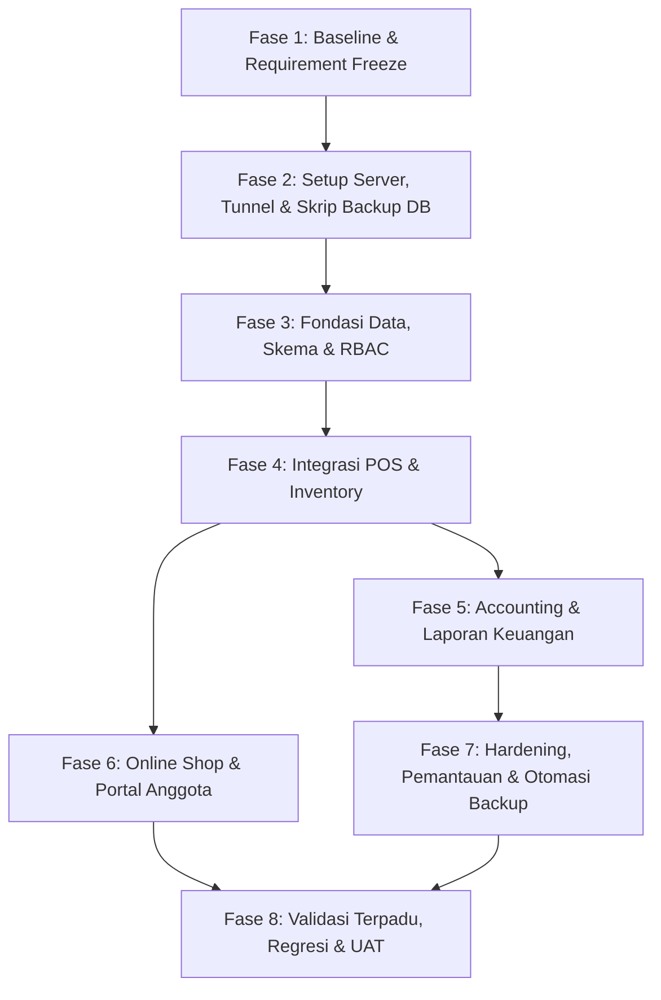

# Rencana Pengembangan Sistem Koperasi (Simpleton)

> **Status Dokumen**: DRAFT TERVALIDASI - SIAP PERSETUJUAN FINAL.  
> Rencana ini telah diselaraskan dengan keputusan arsitektur server (Lokal + Cloudflare Tunnel), strategi backup database, dan model pembukuan double-entry otomatis. **Implementasi kode menunggu instruksi eksplisit untuk memulai fase pertama.**

---

## 1. Latar Belakang dan Pendekatan Pengembangan

Sistem Koperasi Simpleton dibangun di atas fondasi aplikasi yang sudah berjalan (CodeIgniter 3, Ion Auth, Grocery CRUD, MySQL, dan frontend kasir berbasis jExcel/jQuery). Pengembangan sistem tidak melakukan perombakan total (*rewrite from scratch*), melainkan ekspansi bertahap (*incremental evolution*) dengan prinsip:

1. **Mempertahankan POS Eksisting sebagai Basis Utama**: Alur kasir dan transaksi lama tetap beroperasi tanpa disrupsi. Modifikasi UI bersifat minimalis dan hanya dilakukan jika diperlukan untuk mendukung kontrol alur transaksi baru (misal modal F9, input cash/kembalian, pilihan EDC/transfer, voucher).
2. **Kepatuhan Validasi di Backend (Server-Side Enforcement)**: Tidak mengandalkan validasi di browser. Semua aturan bisnis (ketersediaan stok, batas retur, validitas voucher, otorisasi role) wajib divalidasi dan dikunci dengan transaksi database (`trans_begin`, `FOR UPDATE`, `trans_commit`).
3. **Integritas Data dan Jejak Audit**: Data transaksi yang telah tersimpan/bernomor nota tidak boleh dihapus secara fisik (`DELETE`). Pembatalan, koreksi, dan retur dicatat sebagai transaksi pembalik atau status terpisah dengan jejak audit (waktu, user, alasan).
4. **Dependensi Antarmodul Jelas**: Modul Inventory menjadi *single source of truth* ketersediaan barang bagi POS fisik maupun Online Shop. Modul Accounting membaca transaksi tercatat dari POS, Purchasing, dan Simpanan secara konsisten.

---

## 2. Keputusan Arsitektur: Local Server + Cloudflare Tunnel

Berdasarkan evaluasi operasional, arsitektur yang disepakati adalah **Local-First Server dengan Cloudflare Tunnel (`cloudflared`)**:

```
[ KASIR TOKO (LAN) ] ──────────────┐
  - Akses via LAN/IP Lokal         │
  - 100% jalan walau internet mati │
                                   ▼
                   ┌───────────────────────────────┐
                   │   SERVER LOKAL KOPERASI       │
                   │   - Apache / PHP 5.6 (XAMPP)  │
                   │   - Database MySQL (Master)   │
                   │   - Simpleton Web Application │
                   └───────────────┬───────────────┘
                                   │
                     cloudflared tunnel (Encrypted HTTPS)
                                   │
                                   ▼
                   ┌───────────────────────────────┐
                   │      CLOUDFLARE EDGE (WAF)    │
                   │   - koperasiku.my.id (SSL)    │
                   │   - Zero Port Forwarding      │
                   └───────────────┬───────────────┘
                                   │
              ┌────────────────────┴────────────────────┐
              ▼                                         ▼
   [ ANGGOTA (DARI LUAR) ]                   [ PENGURUS / AUDITOR ]
   - Online Shop, Simpanan, SHU              - Laporan Keuangan, RAT
```

### Keunggulan Arsitektur Ini:
1. **Ketahanan Kasir 100% Offline**: Komputer kasir di toko mengakses server melalui Local Area Network (LAN). Jika koneksi internet ISP terputus, kasir tetap melayani pembeli seperti biasa tanpa gangguan atau jeda.
2. **Keamanan Tanpa IP Publik**: Tidak perlu membuka port router (*port forwarding*) yang rawan serangan scanning port. Cloudflare Tunnel menghubungkan server lokal ke jaringan Cloudflare secara *outbound*.
3. **Single Database Instance**: Tidak ada risiko *split-brain* atau konflik baris MySQL replication, karena seluruh data (POS, online shop, simpanan) berada di satu database master lokal.

---

## 3. Strategi Backup Database yang Kuat & Aman

Karena database utama berada di server lokal toko, proteksi data wajib menggunakan strategi standar industri **3-2-1 Backup Strategy**:
- **3** salinan data (1 data produksi + 2 salinan backup).
- **2** media penyimpanan berbeda (SSD/HDD internal server + Harddisk Eksternal / NAS lokal).
- **1** salinan off-site di luar lokasi toko (Cloud Storage terenkripsi).

### Rencana Implementasi Backup Otomatis:

1. **Otomatisasi Script Backup Harian (`mysqldump`)**:
   - Dibuat script batch/powershell yang dieksekusi otomatis oleh **Windows Task Scheduler** setiap hari (misal pukul 23:00 setelah toko tutup).
   - Perintah dump dengan flag konsistensi:  
     `mysqldump --single-transaction --routines --triggers -u root -p[PASS] simpleton > backup.sql`
2. **Kompresi dan Enkripsi**:
   - File dump dikompresi menjadi file `.7z` atau `.zip` menggunakan enkripsi AES-256 ber-password untuk mencegah kebocoran data anggota/keuangan jika file fisik berpindah tangan.
3. **Skema Retensi (Rotation Retention)**:
   - **Harian**: Disimpan selama 14 hari terakhir.
   - **Mingguan**: Disimpan setiap hari Minggu selama 4 minggu.
   - **Bulanan**: Disimpan pada akhir bulan selama 12 bulan.
   - Script membersihkan (*pruning*) file backup yang sudah melebihi masa retensi secara otomatis agar disk tidak penuh.
4. **Off-site Sync ke Cloud**:
   - Menggunakan tool sinkronisasi aman seperti **Rclone** yang dikonfigurasi ke Google Drive / Cloudflare R2 / AWS S3.
   - Script mengunggah file backup harian terenkripsi ke folder cloud off-site setelah proses dump selesai.
5. **Uji Pemulihan (Disaster Recovery Drill)**:
   - Prosedur SOP uji restore backup ke komputer cadangan sebulan sekali untuk memastikan file dump valid dan tidak korup.

---

## 4. Rincian Scope Produk

### 4.1 Point of Sales (POS)
- **Kontrol Tombol F9 & Pencegahan Transaksi Ganda**:
  - Tombol F9 memunculkan modal ringkasan sebelum checkout (bukan langsung kirim request).
  - Terapkan status *loading / disabled* pada tombol submit dan token transaksi unik (idempotency key) untuk mencegah *double click* atau *network duplicate*.
  - Sediakan tombol eksplisit "Batalkan / Kosongkan Keranjang" sebelum disimpan.
- **Integritas Transaksi Tersimpan**:
  - Transaksi yang sudah mendapat nomor nota dan tercatat di database tidak dapat di-edit atau di-delete oleh kasir.
  - Pembatalan transaksi pasca-cetak wajib melalui alur Retur / Pembatalan Resmi dengan otorisasi supervisor/admin dan jejak audit lengkap.
- **Metode Pembayaran**:
  - Pertahankan: Potong Gaji (validasi limit belanja karyawan) dan QRIS.
  - Tambahkan: **EDC (Debit/Kredit)** dengan pencatatan nomor approval/referensi, dan **Transfer Bank** dengan pencatatan rekening tujuan.
  - **Pembayaran Tunai**: Input nominal yang dibayarkan pelanggan, sistem menghitung kembalian secara otomatis, dan angka kembalian dicetak pada struk nota.
- **Voucher Belanja**:
  - Master voucher lokal: kode voucher, tipe (nominal diskon / cashback), nilai, tanggal kedaluwarsa, kuota penggunaan, dan minimum belanja.
  - Validasi voucher langsung di backend saat checkout; cegah penggunaan berulang jika voucher bersifat sekali pakai.
- **Kontrol Ketersediaan Stok**:
  - Tetap pertahankan pemeriksaan backend (`jumlah < qty`). Jika stok tidak cukup, transaksi langsung dibatalkan dalam transaksi DB dan mengembalikan pesan detail barang yang habis.

### 4.2 Inventory & Purchasing
- **Relasi Multi-Kemasan (Dus & Pcs) & Pembongkaran Virtual**:
  - Tabel relasi barcode kemasan (`product_conversions`):
    - Barcode Dus terhubung ke Barcode Pcs dengan kolom `conversion_ratio` (misal 1 Dus = 24 Pcs).
    - Satu barang pcs dapat memiliki beberapa barcode dus dengan rasio berbeda (Pack isi 6, Dus isi 24, Karton isi 48).
  - **Logika Penjualan & Pembongkaran Virtual**:
    - Jika kasir menjual barcode Dus: stok dus berkurang langsung.
    - Jika kasir menjual barcode Pcs tetapi stok pcs fisik di sistem = 0 sementara stok Dus > 0: sistem secara virtual memotong 1 Dus dan menambahkan `(rasio - qty_jual)` ke stok Pcs secara atomik dalam transaksi database.
- **Modul Purchasing**:
  - PO & Penerimaan Barang (`Goods Receipt`):
    - Tambahkan kolom diskon per baris item: opsi persen (`%`) atau nominal (`Rp`).
    - PPN dicatat sebagai **nominal rupiah faktur** (bukan sekadar persentase otomatis), agar nilai total penerimaan klop dengan faktur fisik supplier.
  - **Retur ke Supplier**:
    - Alur pencatatan pengembalian barang rusak / kedaluwarsa ke supplier.
    - Mengurangi jumlah stok barang di gudang dan menghasilkan nota retur supplier untuk penyesuaian hutang dagang atau klaim pengembalian dana.
- **Retur Penjualan (Customer Return)**:
  - Pencatatan retur merujuk ke nomor nota penjualan asli dan baris item yang dibeli.
  - Validasi batas retur: total qty yang diretur tidak boleh melebihi sisa qty yang belum diretur dari transaksi tersebut.
  - Pencatatan kondisi barang:
    - *Layak Jual*: Stok fisik barang bertambah kembali ke master stok.
    - *Rusak / Cacat*: Barang tidak dimasukkan ke stok aktif melainkan ke penampungan barang rusak (*damaged goods pool*).
- **Stok Opname**:
  - Pertahankan alur SO yang sudah ada (penghitungan fisik vs stok sistem).
  - Hasil finalisasi SO mencatat histori penyesuaian (*adjustment log*) beserta nilai rupiah selisih untuk memicu jurnal akuntansi otomatis.

### 4.3 Accounting (Double-Entry Bookkeeping Otomatis)
- **Bagan Akun (Chart of Accounts / COA) Standar Koperasi**:
  - **1xxx ASET**: Kas Toko, Kas Bank (BCA/BRI/Mandiri), Piutang Belanja Anggota (Potong Gaji), Persediaan Barang Dagang.
  - **2xxx KEWAJIBAN**: Hutang Dagang Supplier, Simpanan Sukarela Anggota, PPN Keluaran Belum Disetor.
  - **3xxx EKUITAS**: Simpanan Pokok Anggota, Simpanan Wajib Anggota, Dana Cadangan Koperasi, SHU Tahun Berjalan.
  - **4xxx PENDAPATAN**: Pendapatan Penjualan Toko, Pendapatan Non-Operasional.
  - **5xxx HARGA POKOK PENJUALAN**: Harga Pokok Penjualan (HPP).
  - **6xxx BEBAN OPERASIONAL**: Beban Selisih Stok Opname, Beban Kerusakan/Afkir Barang, Beban Operasional Toko.
- **Mekanisme Auto-Journaling (Triggered Posting)**:
  - **Penjualan POS Tunai/EDC/QRIS**:
    - *Dr. Kas / Bank / Piutang Belanja Anggota*  
    - *Cr. Pendapatan Penjualan Toko*  
    - *Dr. Harga Pokok Penjualan (HPP)*  
    - *Cr. Persediaan Barang Dagang*
  - **Penerimaan Purchasing (Faktur Supplier)**:
    - *Dr. Persediaan Barang Dagang*  
    - *Dr. PPN Masukan (jika ada)*  
    - *Cr. Hutang Dagang Supplier / Kas*
  - **Retur Penjualan**:
    - *Dr. Retur Penjualan*  
    - *Cr. Kas / Piutang Anggota*  
    - *(Jika barang layak jual)*: *Dr. Persediaan Barang Dagang*, *Cr. HPP*
  - **Selisih Stok Opname**:
    - *Dr. Beban Selisih Stok*, *Cr. Persediaan Barang Dagang* (jika fisik < sistem).
    - *Dr. Persediaan Barang Dagang*, *Cr. Pendapatan Penyesuaian Stok* (jika fisik > sistem).
- **Laporan Keuangan Otomatis**:
  - **Neraca (Balance Sheet)**
  - **Laba Rugi (Income Statement)**
  - **Arus Kas (Cash Flow)**
  - **Buku Besar (General Ledger) & Jurnal Umum**
  - **Rekonsiliasi Bank Manual & Laporan Pajak (PPN)**

### 4.4 Online Shop for Member
- **Katalog & Ketersediaan**:
  - Mengambil data produk dan stok langsung dari database Inventory secara real-time.
  - Barang yang stoknya 0 otomatis berstatus tidak dapat dipesan (*out of stock*).
- **Alur Pemesanan & Reservasi Stok**:
  - Anggota memasukkan barang ke keranjang online dan melakukan checkout.
  - Pilihan pemenuhan pesanan (*fulfillment*):
    1. **Ambil di Koperasi (Pick-up)**.
    2. **Dikirim ke Alamat/Bagian Kerja**.
  - Status Pesanan: `Menunggu Pembayaran` -> `Dikonfirmasi` -> `Diproses / Disiapkan` -> `Siap Diambil / Sedang Dikirim` -> `Selesai` / `Dibatalkan`.
  - Reservasi stok sementara saat checkout online dengan batas waktu (*expiry timer*); jika waktu habis dan belum dibayar, reservasi dibatalkan otomatis agar stok kembali tersedia untuk kasir fisik.

### 4.5 Member Account Information (Portal Anggota)
- **Data Kepesertaan**:
  - Profil anggota, NPK/Nomor Anggota, tanggal bergabung, status keanggotaan aktif/pasif.
- **Rekap Belanja Anggota**:
  - Histori transaksi belanja (di POS toko maupun Online Shop), total belanja bulanan, dan sisa limit belanja potong gaji.
- **Simpanan & SHU (Sisa Hasil Usaha)**:
  - Saldo Simpanan Pokok, Simpanan Wajib, dan Simpanan Sukarela.
  - **Buku Mutasi Simpanan**: Catatan riwayat setoran, penarikan, tanggal, saldo berjalan, dan nomor bukti transaksi per anggota sebagai arsip pertanggungjawaban dalam Rapat Anggota Tahunan (RAT).
  - Estimasi dan rincian alokasi SHU per anggota (berdasarkan formula Jasa Modal Simpanan dan Jasa Usaha Belanja yang berlaku di koperasi).
- **Informasi Publik Koperasi**:
  - Rekap ringkas kinerja keuangan koperasi yang disahkan pengurus.
  - Dokumen/Laporan Rapat Anggota Tahunan (RAT) yang dapat diunduh anggota.

### 4.6 Laporan (Reporting Engine)
- **Laporan Penjualan**: Harian per shift kasir, bulanan per supplier/kategori, margin laba kotor.
- **Laporan Persediaan**: Mutasi stok, kartu stok per barcode, barang slow/fast moving, barang expired.
- **Laporan Purchasing & Hutang**: Jatuh tempo hutang supplier, riwayat penerimaan vs PO, riwayat retur supplier.
- **Ekspor Dokumen**: Format cetak thermal POS, cetak dokumen resmi (A4), dan ekspor ke Excel/PDF.

### 4.7 Authentication dan Role-Based Access Control (RBAC)
- Memetakan 5 Role resmi di Ion Auth:
  1. **Kasir**: Akses transaksi POS, cek harga, buka/tutup shift kasir, cetak ulang nota shift aktif.
  2. **Management**: Akses operasional toko, purchasing, penerimaan barang, stok opname, dan katalog produk online.
  3. **Pengurus**: Akses laporan keuangan, approval retur/diskon khusus, pengelolaan simpanan/SHU, publikasi laporan RAT.
  4. **Anggota**: Akses belanja online, melihat profil keanggotaan, histori belanja, dan saldo simpanan pribadi.
  5. **Superadmin**: Akses konfigurasi sistem, manajemen user & permission, audit trail, backup/restore.
- Otorisasi ditegakkan di backend controller, bukan sekadar menyembunyikan navigasi di view.

---

## 5. Rencana Tahapan Eksekusi (8 Tahapan Terstruktur)



### Rincian Tiap Fase:

- **Fase 1: Dokumentasi Baseline & Verifikasi Prasyarat** `[SELESAI]`
  - Konfirmasi temuan tes terdahulu, aturan bisnis, dan formula SHU/mutasi simpanan untuk RAT.
- **Fase 2: Setup Server, Cloudflare Tunnel & Skrip Backup Otomatis** `[SELESAI - Modifikasi Tunnel Lanjut Nanti]`
  - Script otomatisasi backup database (mysqldump + 7-Zip AES-256 + Task Scheduler) telah dibuat dan diuji.
  - Binary `cloudflared.exe` dan batch helper telah disediakan; konfigurasi domain lanjutan ditunda sementara.
- **Fase 3: Menyiapkan Fondasi Skema Database & Otorisasi Backend** `[SELESAI]`
  - Skrip migrasi SQL idempoten ([application/sql/phase3_foundation.sql](file:///g:/xampp/htdocs/simpleton/application/sql/phase3_foundation.sql)) telah dieksekusi di MySQL.
  - Tabel konversi dus/pcs, voucher, pembayaran POS, retur penjualan/supplier, buku mutasi simpanan RAT, dan COA akuntansi telah aktif.
  - 5 Role resmi Ion Auth (`admin`, `members`, `kasir`, `management`, `pengurus`) telah terdaftar.
  - Dokumentasi skema dan matriks RBAC tersimpan di `docs/database/` dan `docs/auth/`.
- **Fase 4: Mengintegrasikan POS dan Inventory** `[SELESAI]`
  - `[SELESAI]` Menambahkan modal konfirmasi F9, tombol kosongkan keranjang, dan anti-double submit dengan nota idempoten di `kasir.js`.
  - `[SELESAI]` Menambahkan metode bayar EDC, transfer, serta input tunai/kembalian dan rincian pembayaran di struk.
  - `[SELESAI]` Menerapkan validasi voucher lokal di backend dan mencatat kuota serta riwayat pemakaian.
  - `[SELESAI]` Menyediakan pengelolaan relasi konversi dus/pcs dan pembongkaran virtual multi-kemasan saat checkout.
  - `[SELESAI]` Menerapkan form dan endpoint retur penjualan dengan batas kuantitas kumulatif, kondisi barang, dan kontrol penambahan stok.
  - `[SELESAI]` Menerapkan alur draft dan persetujuan retur supplier dengan validasi kuantitas penerimaan, stok, dan jejak petugas.
  - `[SELESAI]` Mencatat diskon per baris (persen atau nominal) dan PPN dalam nominal rupiah faktur; validasi sisi server dan rincian total penerimaan telah diuji.
- **Fase 5: Membangun Modul Accounting & Laporan Keuangan** `[SELESAI]`
  - `[SELESAI]` Memposting jurnal double-entry dalam transaksi yang sama untuk POS, penerimaan purchasing, retur penjualan, retur supplier, dan selisih stok opname.
  - `[SELESAI]` Menyediakan dashboard jurnal, laporan laba-rugi, saldo akun neraca sampai tanggal akhir, dan perubahan bersih kas/bank per periode; akses dibatasi ke admin, management, dan pengurus.
  - `[SELESAI]` Menampilkan jumlah transaksi historis yang belum memiliki jurnal; transaksi lama tidak di-backfill otomatis karena sebagian tidak mempunyai metode pembayaran/HPP yang dapat dipercaya.
  - `[SELESAI]` Menyediakan arus kas terklasifikasi berbasis akun lawan jurnal, buku besar per akun dengan saldo berjalan, dan ringkasan serta rincian mutasi PPN.
  - `[SELESAI]` Menyediakan rekonsiliasi bank manual untuk input mutasi rekening koran, pencocokan satu-ke-satu dengan jurnal bank, dan peninjauan selisih saldo.
  - `[SELESAI]` Menyediakan pembuatan dan penguncian periode akuntansi tanpa jurnal penutupan SHU; penutupan menolak periode mendatang, transaksi sumber yang belum terposting, dan jurnal tidak seimbang.
- **Fase 6: Membangun Online Shop & Portal Informasi Anggota**
  - Membangun katalog barang online anggota yang terhubung ke stok inventory.
  - Alur order fulfillment (ambil di toko / kirim) beserta reservasi stok sementara.
  - Membangun dashboard anggota: info kepesertaan, rekap belanja, simpanan, estimasi SHU, dan unduh laporan RAT.
- **Fase 7: Hardening, Pemantauan & Uji Pemulihan (Disaster Recovery)**
  - Pengujian uji pulih backup (*restore drill*).
  - Pengujian ketahanan koneksi internet toko putus saat transaksi kasir lokal berlangsung.
- **Fase 8: Validasi Terpadu Lintas Modul & Pengujian Regresi**
  - Uji alur menyeluruh dari transaksi POS -> stok berkurang -> jurnal terbentuk -> laporan keuangan ter-update.
  - Uji batas: stok 0, retur melebihi batas, voucher kedaluwarsa, checkout concurrent.

---

## 6. Keputusan Operasional Lanjutan

Beberapa detail teknis yang perlu diselaraskan saat implementasi per fase:
1. **Konversi Pembongkaran Dus ke Pcs**: Apakah pembongkaran virtual saat stok pcs habis otomatis menambahkan sisa pcs ke tabel `stok` (disarankan: Ya, otomatis agar stok pcs selalu konsisten).
2. **Formula Alokasi SHU & Mutasi Simpanan**:
   - Menentukan bobot alokasi SHU anggota (misal 40% Jasa Modal Simpanan, 60% Jasa Usaha Belanja).
   - Diperhitungkan dalam pertanggungjawaban RAT, sehingga wajib tersedia buku/kartu mutasi simpanan anggota lengkap (setoran, penarikan, saldo akhir) dengan bukti transaksi/jejak audit.
3. **Pembayaran Online Shop Anggota**: Memilih metode yang aktif di web anggota (Potong Gaji / Saldo Simpanan Sukarela / Transfer Bank).
